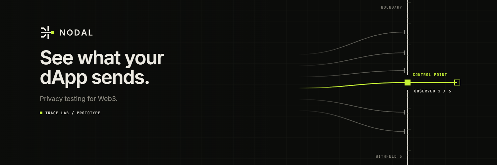

# Nodal

**Nodal makes the request layer of Web3 visible: which wallet data a dApp sends, to whom, and in which field.**

Network privacy protects the route. It does not change what an application chooses to put in the request. A wallet address in an analytics call, a transaction hash in an error report, an ENS name in a tracking pixel: these leaks are written by the app itself, they travel over any network, and the user never sees them. Nodal turns them into evidence an engineer can act on.

## Where Nodal sits

```
   NETWORK LAYER                 REQUEST LAYER                     ON-CHAIN
   who · when · from where       what the dApp sends               public ledger

  ┌───────────────────────┐    ┌────────────────────────────┐    ┌─────────────────┐
  │  mixnets · VPNs · Tor │──► │  wallet  ·  host  ·  field │──► │  explorers      │
  │  e.g. the Nym mixnet  │    │  ███  NODAL TRACE LAB  ███ │    │  indexers       │
  └───────────────────────┘    └────────────────────────────┘    └─────────────────┘
   protected by network          Nodal's scope                     public by design
   privacy systems
```

A request can cross a mixnet untouched and still carry its user's wallet address in the body. Protecting one layer does not protect the next. Nodal focuses on the one the application controls.

## Trace Lab — the first public layer

Trace Lab reads a captured session of a dApp, entirely in the browser, and names every wallet-related value that left it: the receiving host, the request, the exact field, and whether the evidence is direct or a heuristic guess. No wallet connection. No uploads. Every finding says how it could be wrong.

<p align="center">
  
</p>

## The next layer is forming

**Privacy has more than one layer.** Network metadata is one. Wallet requests are another. Nym's mixnet is built for the first; Nodal is built to see the second.

The question Nodal is exploring next: when a wallet routes its RPC through a privacy network, such as Nym's [anon-rpc worker](https://github.com/nymtech/anon-rpc-worker) for the draft [anon-rpc specification](https://ethereum.github.io/anon-rpc/spec/), can a test prove which requests stayed on the private route, and which bypassed it?

`EXPLORING` · `NO INTEGRATION ANNOUNCED`

## What's in this organization

| Repository | What it is |
|---|---|
| [**Nodal**](https://github.com/nodalsi/Nodal) | Trace Lab: request-layer analysis of captured dApp traffic, with a synthetic sample and Playwright wallet-flow examples (injected wallet and Reown AppKit). |

## Roadmap

| | Status |
|---|---|
| Trace Lab · wallet-flow examples | `IN DEVELOPMENT` |
| Privacy CI · Observed Data Manifest · Nodal Privacy Lab | `PLANNED` |
| Privacy-routed RPC testing (Nym mixnet, anon-rpc) | `EXPLORING` |
| Combined network-and-request analysis | `EXPLORING` |
| Live | Nothing yet |

## Start here

- [Documentation](https://github.com/nodalsi/Nodal/tree/main/docs) · [Privacy across layers](https://github.com/nodalsi/Nodal/blob/main/docs/privacy-across-layers.md) · [What Nodal can and cannot show](https://github.com/nodalsi/Nodal/blob/main/docs/what-nodal-can-and-cannot-show.md)
- [Reproduce the sample trace](https://github.com/nodalsi/Nodal/blob/main/docs/reproduce-the-sample.md) · [Roadmap](https://github.com/nodalsi/Nodal/blob/main/docs/roadmap.md)
- [Report a vulnerability](https://github.com/nodalsi/Nodal/security/advisories/new)

---

<sub>© 2026 Nodal · [nodaltrace.si](https://nodaltrace.si) · [contact@nodaltrace.si](mailto:contact@nodaltrace.si) · Nodal is independent. Nym is referenced for technical context; no integration, partnership or endorsement exists.</sub>
