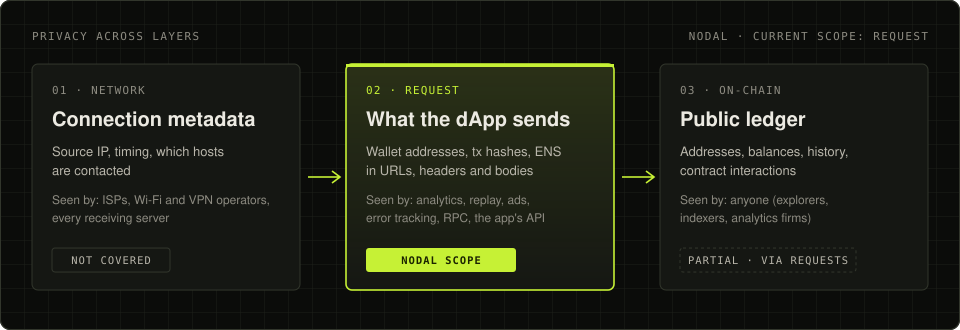
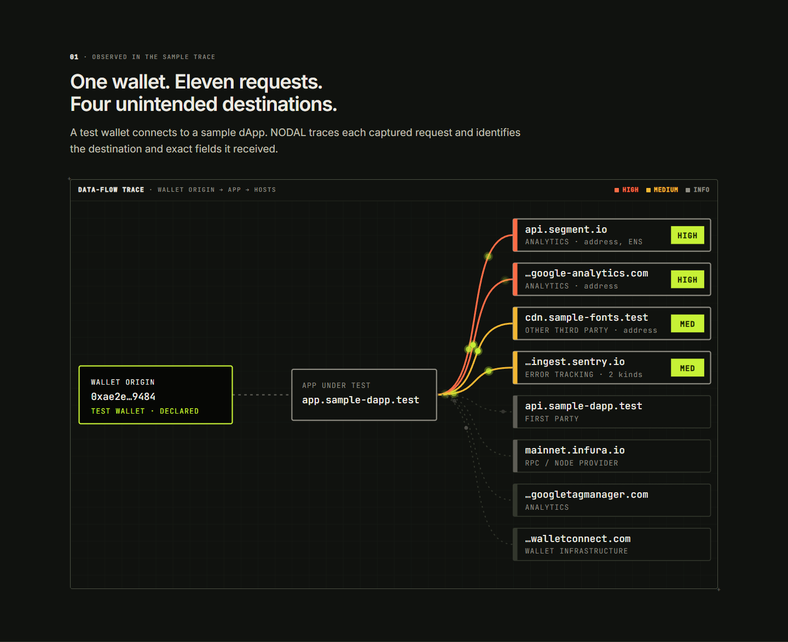

  <picture>
    <source media="(prefers-color-scheme: dark)" srcset="assets/nodal-logo-on-dark.svg">
    
  </picture>

<h3 align="center">Privacy testing for Web3.</h3>

NODAL shows what a wallet reveals when it connects to Web3, starting with the data a dApp sends in its requests.

 

## A year in the making. Built for what comes next.

NODAL began with one question: what does a wallet reveal when it connects to Web3? The Trace Lab is the first public layer of a broader effort to map privacy across network traffic, wallet requests, and on-chain activity.

## Privacy has more than one layer

Network metadata is one layer. Wallet requests are another. NODAL is building visibility into what a request reveals.

  

## Repository

| Repository | What it is | Status |
|---|---|---|
| [**Nodal**](https://github.com/nodalsi/Nodal) | Trace Lab: local-first analysis of captured dApp requests. Finds wallet addresses, transaction hashes and ENS names, and shows which host received each one, in which field. Includes a synthetic sample and Playwright wallet-flow examples. | In development |

  

## Links

- **Source:** [github.com/nodalsi/Nodal](https://github.com/nodalsi/Nodal)
- **Documentation:** [docs](https://github.com/nodalsi/Nodal/tree/main/docs)
- **Security reports:** see [SECURITY.md](https://github.com/nodalsi/Nodal/blob/main/SECURITY.md)
- **Website:** link added when it goes live

## Status

| Status | |
|---|---|
| **Live** | Nothing yet |
| **In development** | Trace Lab, wallet-flow examples |
| **Planned** | Privacy CI, Observed Data Manifest, NODAL Privacy Lab pilot |
| **Exploring** | Privacy-routed RPC testing; combined network-and-request analysis |

## Principles

- **Evidence over claims.** Every finding names the request, the host and the field, and says how it could be wrong.
- **Local-first.** Traces are read in the browser tab. No uploads, no wallet connection.
- **Honest scope.** NODAL shows what was observed in a capture. It does not prove that an app never leaks data.

NODAL is independent. Projects named in its documentation, including Nym, are referenced for technical context only and do not endorse, fund, advise or collaborate with NODAL.
